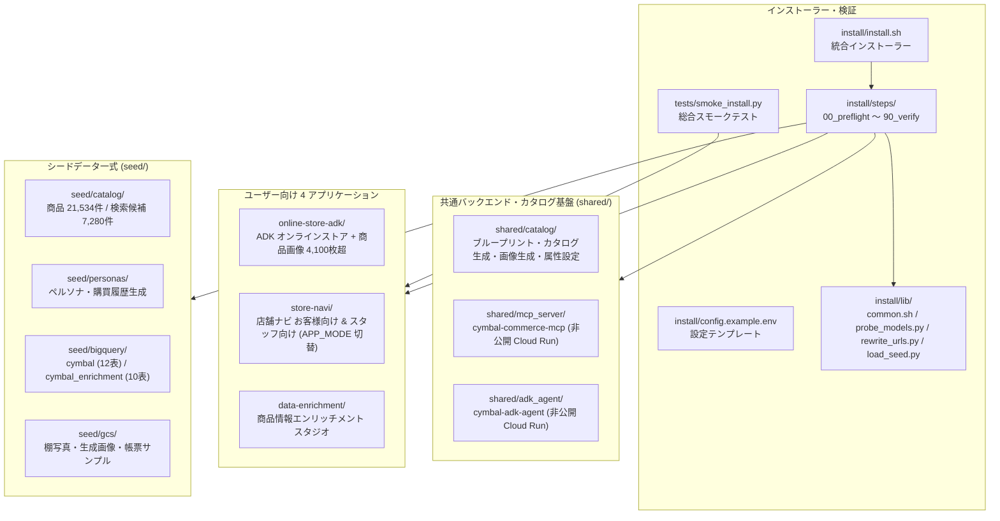

# AGENTS.md — AI エージェント（Jetski / Gemini CLI）向け作業指針

このリポジトリ（**Cymbal Retail エージェンティック・コマース デモ**）を Jetski やコーディングエージェントで開いた際は、本ドキュメントの指針および同梱スキルに従って作業を進めてください。すべての案内・レポートは **日本語** で出力してください。

---

## 1. 最優先スキル（作業前に必ず参照）

ユーザーの依頼内容に応じて、まず以下の `SKILL.md` を読み込んで手順どおりに実行してください。

| ユーザーの依頼内容 | 読み込むスキル | 概要 |
|---|---|---|
| 「このデモを自分の GCP プロジェクトにインストールしたい」「環境を構築して」 | `_agents/skills/install-cymbal-demo/SKILL.md` | `PROJECT_ID`・`REGION` の確認 → 事前チェック → `install/install.sh` 実行 → 公開設定案内 → `smoke_install.py` 検証 |
| 「ブランド名・ロゴ・色を変えたい」「商品・ペルソナ・店舗データ・モデルを変更したい」 | `_agents/skills/customize-cymbal-demo/SKILL.md` | カタログ再生成・Gemini 画像生成・ペルソナ/店舗編集・エージェント指示変更と差分ステップ再デプロイ |

---

## 2. リポジトリ構成マップ

| ディレクトリ / ファイル | 役割 |
|---|---|
| `install/` | ワンコマンドインストーラー (`install.sh`)、アンインストーラー (`uninstall.sh`)、各フェーズスクリプト (`steps/`) |
| `shared/catalog/` | 商品ブループリント (`blueprint/*.json`)、Retail カタログ展開、Gemini パックショット生成 (`gen_vertex.py`) |
| `shared/mcp_server/` | 検索・顧客プロフィール・購買履歴・夕食献立ツールを提供する FastMCP サーバー (`cymbal-commerce-mcp`) |
| `shared/adk_agent/` | Google ADK ベースのオンラインストア用 AIコンシェルジュ (`cymbal-adk-agent`) |
| `online-store-adk/` | AI 検索・音声対話・夕食セット提案・カート〜配送追跡を備えた EC ストア (`cymbal-site-adk`) |
| `store-navi/` | 単一コードベースから `APP_MODE=customer` (`cymbal-store-app`) と `APP_MODE=staff` (`cymbal-store-staff`) をデプロイする店舗アプリ |
| `data-enrichment/` | Gemini による属性抽出・品質ゲート・GMC 出力・画像生成・コスト試算スタジオ (`cymbal-data-enrichment`) |
| `flyer-studio/` | 特売チラシ自動レイアウト・承認・PDF/JPEG 出力スタジオ (`cymbal-flyer-studio`) |
| `spec-banner/` | Cymbal Retail ブランドの店頭機能表・POP 自動生成スタジオ (`cymbal-spec-banner`) |
| `seed/` | カタログ JSONL、BigQuery スナップショット (`jsonl.gz` + `schema.json`)、GCS 初期画像アセット |
| `docs/` | 詳細ドキュメント (`ARCHITECTURE.md`, `CUSTOMIZE.md`, `DATA.md`, `TROUBLESHOOTING.md`) |

---

## 3. 厳守すべきガードレール（禁止事項）

> [!CAUTION]
> 以下のルールは、いかなるエラー発生時であっても**例外なく厳守**してください。

1. **組織ポリシー・IAM 制限の回避禁止**
   - 企業の組織ポリシー（例: `iam.allowedPolicyMemberDomains`）により Cloud Run の `allUsers`（未認証公開）や Retail Completion 用の外部システム SA 付与が拒否された場合、`gcloud resource-manager org-policies` の変更や `--no-invoker-iam-check` などの回避策を**絶対に実行しないでください**。
   - 公開アクセスがブロックされた場合は、`80_public` が出力する手順に従い、ユーザーが Cloud Console の「セキュリティ」タブで「パブリック アクセスを許可」を手動で有効化するよう案内し、検証は `python3 tests/smoke_install.py --config install/config.env --id-token` で実施してください。
2. **対象プロジェクト確認の徹底**
   - ユーザーから明示的に `PROJECT_ID` が指定されていない状態で、勝手に `gcloud config get-value project` の既存プロジェクトへデプロイしないでください。必ず対象プロジェクト ID とリージョン（既定: `asia-northeast1`）をユーザーに確認してください。
3. **秘密情報・環境固有ファイルのコミット禁止**
   - `install/config.env`、`install/.state/`、サービスアカウント鍵 JSON、アクセストークン等を Git にコミットしないでください。
4. **シード原本の不変維持**
   - インストール時の URL・バケット名置換は `install/lib/rewrite_urls.py` および `install/lib/load_seed.py` が一時ファイル / `install/.state/` 上で自動実行します。`seed/` 配下の原本に特定プロジェクトの URL を直接書き込まないでください（商品やペルソナ自体をカスタマイズする場合を除く）。
5. **最新 Gemini モデルの自動選択**
   - プロジェクトによって利用可能な Gemini モデルが異なります。モデル名をハードコードせず、`15_models` (`install/lib/probe_models.py`) による自動プローブ結果（または `install/config.env` での明示指定）を使用してください。
