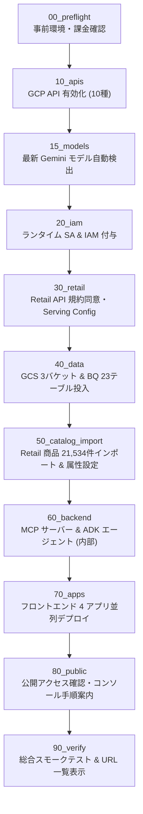

# INSTALL.md — インストール手順書（手動・一括実行ランブック）

本書では、Jetski を使わずにターミナルから Cymbal Retail エージェンティック・コマース デモを Google Cloud プロジェクトへ構築するための手順を、**一括自動インストール**と**ステップ別実行**の両方で詳しく解説します。

---

## 1. 事前準備（前提条件）

### 1.1 必要なローカルツール

以下のコマンドがインストールされていることを確認してください。

| ツール | 用途 | 確認コマンド / インストール方法 |
|---|---|---|
| Google Cloud SDK (`gcloud`, `bq`) | GCP リソース作成・BigQuery ロード・Cloud Run デプロイ | `gcloud --version && bq version` |
| Python 3 (`python3` 3.10 以上) | URL 書き換え・モデルプローブ・シード投入・スモークテスト（標準ライブラリのみで動作） | `python3 --version` |
| `curl` | ヘルスチェック・API 疎通確認 | `curl --version` |
| `uv`（任意・推奨） | カスタマイズ時の商品画像生成 (`gen_vertex.py`) 等で便利 | `curl -LsSf https://astral.sh/uv/install.sh \| sh` |

### 1.2 Google Cloud プロジェクトと権限要件

1. **課金 (Billing) が有効**な Google Cloud プロジェクトを用意してください（新規プロジェクト推奨）。
2. 作業ユーザーにプロジェクトの **オーナー (`roles/owner`)** または以下の権限があることを確認してください:
   - Service Usage 管理者 (`roles/serviceusage.serviceUsageAdmin`)
   - サービス アカウント管理者 (`roles/iam.serviceAccountAdmin`) & プロジェクト IAM 管理者 (`roles/resourcemanager.projectIamAdmin`)
   - Cloud Run 管理者 (`roles/run.admin`) & Cloud Build 編集者 (`roles/cloudbuild.builds.editor`)
   - BigQuery 管理者 (`roles/bigquery.admin`) & Storage 管理者 (`roles/storage.admin`)
   - Retail 管理者 (`roles/retail.admin`) & Vertex AI ユーザー (`roles/aiplatform.user`)
3. ローカル端末で Google Cloud にログインします:
   ```bash
   gcloud auth login
   ```

---

## 2. 設定ファイル (`install/config.env`) の作成

```bash
cp install/config.example.env install/config.env
```

`install/config.env` をエディタで開き、最低限 `PROJECT_ID` を設定します:

```bash
PROJECT_ID="your-gcp-project-id"   # ← ご自身のプロジェクト ID に変更
REGION="asia-northeast1"           # 東京リージョン（既定）
SERVICE_PREFIX="cymbal"            # サービス名プレフィックス（既定）
VOICE_ENABLED="1"                  # 音声入力・読み上げ有効（既定）
```

> **補足**: `GEMINI_MODEL` / `AGENT_MODEL` / `ENRICH_GEMINI_MODEL` / `IMAGE_MODEL` を空欄のままにしておくと、`15_models` ステップで対象プロジェクトにおいて利用可能な最新の Gemini モデルが自動検出されます。

---

## 3. 一括インストール（推奨）

以下のコマンド 1 つで、事前チェックから全データ投入・6 サービスデプロイ・スモークテストまで順番に実行されます（所要時間目安: 約 12〜20 分）。

```bash
./install/install.sh
```

### よく使うオプション

```bash
# 実行内容と算出 URL を変更なしで事前確認（ドライラン）
./install/install.sh --dry-run

# コマンド引数でプロジェクト ID とリージョンを直接指定
./install/install.sh --project your-gcp-project-id --region asia-northeast1

# 途中で中断した場合に、完了済みステップをスキップして再開
./install/install.sh --resume

# 特定のステップから最後まで実行（例: カタログインポート以降）
./install/install.sh --from 50_catalog_import

# 特定のステップだけを実行（例: フロントエンド再デプロイと検証のみ）
./install/install.sh --steps 70_apps,90_verify

# 4 アプリのビルドを並列ではなく 1 つずつ直列で実行したい場合
./install/install.sh --sequential
```

---

## 4. ステップ別詳細リファレンス（全 11 ステップ）

個別に動作を確認しながら進めたい場合は、`./install/install.sh --steps <ステップ名>`（または `bash install/steps/<ステップ名>.sh`）を上から順に実行できます。



### ステップ 1: `00_preflight` — 事前チェック
```bash
./install/install.sh --steps 00_preflight
```
- **処理内容**: `gcloud` / `bq` / `python3` / `uv` の有無、アクティブ認証、プロジェクト存在確認、`billingEnabled=True` の確認、`PROJECT_NUMBER` の解決、バケット・データセット・6 サービスの予定 URL 一覧表の表示を行います。
- **確認ポイント**: 設定一覧表に表示された `PROJECT_ID` と `REGION` が意図どおりであることを確認します。

### ステップ 2: `10_apis` — Google Cloud API の有効化
```bash
./install/install.sh --steps 10_apis
```
- **有効化される API**:
  `retail.googleapis.com`, `aiplatform.googleapis.com`, `run.googleapis.com`, `cloudbuild.googleapis.com`, `artifactregistry.googleapis.com`, `bigquery.googleapis.com`, `storage.googleapis.com`, `speech.googleapis.com`, `texttospeech.googleapis.com`, `iam.googleapis.com`

### ステップ 3: `15_models` — 最新 Gemini モデルの自動検出
```bash
./install/install.sh --steps 15_models
```
- **処理内容**: `install/lib/probe_models.py` が Vertex AI (`global`) に対して最新候補順で `generateContent` と Function Calling をテストし、結果を `install/.state/models.env` に書き出します。
- **確認コマンド**: `cat install/.state/models.env`

### ステップ 4: `20_iam` — サービスアカウントと IAM 設定
```bash
./install/install.sh --steps 20_iam
```
- **処理内容**:
  - ランタイム用サービスアカウント `${SERVICE_PREFIX}-runtime@${PROJECT_ID}.iam.gserviceaccount.com` を作成し、最小権限ロール（`retail.editor`, `aiplatform.user`, `bigquery.dataEditor`, `bigquery.jobUser`, `storage.objectAdmin`, `speech.client`, `logging.logWriter`）を付与します。
  - Cloud Run ソースビルド用に `${PROJECT_NUMBER}-compute@developer.gserviceaccount.com` へ `roles/run.builder` を付与します。

### ステップ 5: `30_retail` — Vertex AI Search for Commerce の初期設定
```bash
./install/install.sh --steps 30_retail
```
- **処理内容**: Retail API (`v2alpha`) の利用規約同意 (`acceptTerms`)、`SOLUTION_TYPE_SEARCH` の登録 (`enrollSolution`)、`default_search` Serving Config の作成と動的ファセット (`dynamicFacetSpec=ENABLED`) の有効化、`completionConfig` の設定を行います。

### ステップ 6: `40_data` — GCS バケット・BigQuery シードデータの投入
```bash
./install/install.sh --steps 40_data
```
- **処理内容**: `install/lib/load_seed.py` を実行し、以下を冪等に処理します:
  1. GCS バケット 3 件（`${PROJECT_ID}-catalog`, `${PROJECT_ID}-store-navi`, `products_images_${PROJECT_ID}`）を均一バケットレベルアクセスで作成し、`seed/gcs/` 内の棚写真・生成画像・帳票サンプルをアップロード。
  2. `seed/catalog/products_retail.jsonl` の商品・画像 URL を対象プロジェクトの `$ONLINE_STORE_URL` に書き換えて `install/.state/products_retail.rewritten.jsonl` を生成し、BigQuery `cymbal.products`（21,534 件）にロード。
  3. `seed/bigquery/cymbal/`（12 テーブル）および `seed/bigquery/cymbal_enrichment/`（10 テーブル）内の旧バケット名・URL・プロジェクト参照を対象プロジェクトの値へ置換した上で、明示スキーマ (`*.schema.json`) を指定してロード。
- **確認コマンド**:
  ```bash
  bq ls "${PROJECT_ID}:cymbal"
  bq ls "${PROJECT_ID}:cymbal_enrichment"
  ```

### ステップ 7: `50_catalog_import` — Retail API 商品インポートと属性設定
```bash
./install/install.sh --steps 50_catalog_import
```
- **処理内容**:
  1. 書き換え済みカタログを `gs://${CATALOG_BUCKET}/catalog/` に保存し、Retail API `branches/0/products:import`（`FULL` リコンシリエーション）を起動して完了までポーリング（成功件数 20,000 件以上を検証）。
  2. `shared/catalog/set_attributes_config.py` でカスタム属性（`on_sale`, `dishes`, `allergens`, `drug_class` 等 20 属性）の検索・ファセット設定を適用。
  3. オートコンプリートデータのインポートを試行（組織ポリシーにより外部システム SA への BigQuery 権限付与が拒否された場合は警告のみ表示し、同梱のローカル JSONL 7,280 件へ安全にフォールバック）。

### ステップ 8: `60_backend` — 内部バックエンドのデプロイ
```bash
./install/install.sh --steps 60_backend
```
- **処理内容**:
  1. `shared/mcp_server/deploy.sh` により `cymbal-commerce-mcp` を `--no-allow-unauthenticated` でデプロイし、ランタイム SA に `roles/run.invoker` を付与。
  2. `shared/adk_agent/deploy.sh` により `cymbal-adk-agent` を `--no-allow-unauthenticated` でデプロイ（`MCP_URL` 連携）し、ランタイム SA に `roles/run.invoker` を付与。

### ステップ 9: `70_apps` — ユーザー向け 4 アプリのデプロイ
```bash
./install/install.sh --steps 70_apps
```
- **処理内容**: 4 つの Cloud Run サービス（`cymbal-site-adk`, `cymbal-store-app`, `cymbal-store-staff`, `cymbal-data-enrichment`）に相互リンク URL と自動検出された最新 Gemini モデルを注入して並列デプロイします。デプロイ後に実測 URL を確認し、予測 URL と差異がある場合は環境変数を自動更新します。

### ステップ 10: `80_public` — 公開アクセスの確認とコンソール案内
```bash
./install/install.sh --steps 80_public
```
- **処理内容**: 4 つのフロントエンド URL に対する匿名アクセスを確認します。組織ポリシーにより `allUsers` がブロックされている場合は、ポリシーを一切変更せず、Cloud Console の「セキュリティ」タブから「パブリック アクセスを許可」を有効化する手順と、ID トークン / プロキシでの確認コマンドを表示します。

### ステップ 11: `90_verify` — 総合スモークテスト
```bash
./install/install.sh --steps 90_verify
# または単体実行:
python3 tests/smoke_install.py --config install/config.env
```
- **処理内容**: 公開アクセスと ID トークン認証を自動判別し、全 4 サービスのヘルスチェック・カタログ件数・検索・パーソナライズ推薦・ADK AIコンシェルジュ夕食提案 SSE・店舗在庫/ルート計算・スタッフ API・エンリッチメント集計/モデル/コスト API・ヘッダー相互リンク URL を一括検証します。

---

## 5. アンインストール（リソース削除）手順

デモ環境が不要になった場合は、`install/uninstall.sh` でクリーンアップできます。

```bash
# Cloud Run サービス（6 件）のみ削除（BigQuery データセットと GCS バケットは保持）
./install/uninstall.sh

# Cloud Run サービスに加えて、BigQuery データセット（2 件）・GCS バケット（3 件）・ランタイム SA も完全削除
./install/uninstall.sh --purge-data --delete-sa
```

誤削除防止のため、実行時にプロジェクト ID の手入力確認が求められます（自動化する場合は `--yes` を付与）。
