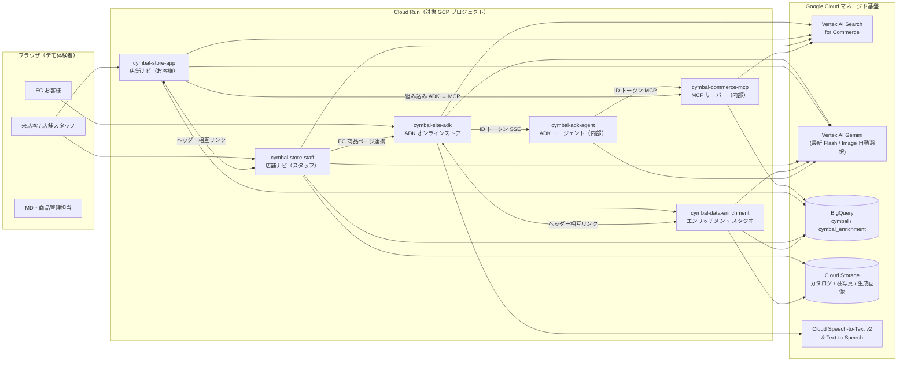

# Cymbal Retail エージェンティック・コマース デモ

**Cymbal Retail（シンバル・リテール）エージェンティック・コマース デモ**は、Google Cloud の **Vertex AI Search for Commerce (Retail API)**、**Agent Development Kit (ADK)**、**Model Context Protocol (MCP)**、および最新の **Gemini モデル**を組み合わせた総合小売・ネットスーパー・実店舗連携・商品マスタ高度化のリファレンス実装パッケージです。

任意の Google Cloud プロジェクトに対して、アプリケーション一式（Cloud Run 8 サービス: 公開 Web 6 + 内部バックエンド 2）と検証済みデモデータ（商品カタログ 21,534 件・AI 生成商品画像 4,100 枚超・店舗レイアウト・エンリッチメント結果・チラシ/機能表シード）を再現性高くインストールし、提案先のお客様に合わせて自由にカスタマイズできます。

---

## デモを構成する 6 つのアプリケーションと 2 つのバックエンド

| 種別 | サービス名（既定） | ディレクトリ | 主なデモ体験 |
|---|---|---|---|
| 公開 Web | `cymbal-site-adk` | `online-store-adk/` | **ADK オンラインストア**: AI Commerce Search 検索・動的ファセット・AI 概要、ADK AIコンシェルジュ（アレルギー考慮の夕食献立セット提案・比較表・カート投入〜配送枠選択〜注文確定・配達追跡）、音声入出力（STT / Chirp 3 HD TTS） |
| 公開 Web | `cymbal-store-app` | `store-navi/` (`APP_MODE=customer`) | **店舗ナビ（お客様向け）**: 来店店舗のリアルタイム在庫検索、フロアマップ上の棚位置ピン表示・最短お買い物ルート案内、店内 AIコンシェルジュ、パーソナルクーポン |
| 公開 Web | `cymbal-store-staff` | `store-navi/` (`APP_MODE=staff`) | **店舗ナビ（スタッフ向け）**: 売場写真を Gemini Vision で解析してゴンドラ番号・段・商品を自動認識しワンタップで棚位置登録、全店横断在庫照会・在庫数更新、フロアマップ棚番管理 (`/admin`) |
| 公開 Web | `cymbal-data-enrichment` | `data-enrichment/` | **商品情報エンリッチメント スタジオ**: レガシー商品マスタ・帳票 PDF/Excel/ラベル画像からの属性自動抽出、3 段階品質ゲート（自動承認 / 要レビュー / 却下）、GMC 会話型コマースフィード生成、季節シーン画像生成、Gemini モデル別トークン・コスト試算 |
| 公開 Web | `cymbal-flyer-studio` | `flyer-studio/` | **チラシ作成スタジオ**: AI による特売チラシ自動レイアウト・価格相場チェック・承認アーカイブ・PDF/JPEG 出力 |
| 公開 Web | `cymbal-spec-banner` | `spec-banner/` | **機能表・POP 自動生成スタジオ**: Cymbal Retail ブランドの店頭ディスプレイ機能表・3D ドア図入り POP の作成・Excel 取込・AI スペック補完・PDF/JPEG 出力 |
| 内部 API | `cymbal-adk-agent` | `shared/adk_agent/` | **ADK AIコンシェルジュ**: Google ADK + 最新 Gemini モデルによるマルチターン接客・ツールオーケストレーション（IAM 認証・内部公開） |
| 内部 API | `cymbal-commerce-mcp` | `shared/mcp_server/` | **Commerce MCP サーバー**: Retail API 検索・顧客プロフィール・購買履歴・夕食セット構築を標準 MCP ツールとして提供（IAM 認証・内部公開） |

---

## システム全体アーキテクチャ



---

## クイックスタート（3 分で開始）

### 方法 A: Jetski（AI エージェント）に任せてインストール

このリポジトリを Jetski で開き、以下のように話しかけるだけで対話的にインストールから疎通確認まで完了します（`AGENTS.md` と `_agents/skills/install-cymbal-demo/SKILL.md` が自動的に読み込まれます）。

```text
このデモを GCP プロジェクト <YOUR_PROJECT_ID>（リージョン: asia-northeast1）にインストールして動作確認してください。
```

### 方法 B: コマンドラインからワンコマンドでインストール

前提条件: `gcloud`、`bq`、`python3` がインストール済みで、デプロイ先 GCP プロジェクトで**課金 (Billing) が有効**であること。

```bash
# 1. リポジトリの取得
git clone https://github.com/minsoojun-cloud/cymbal-retail-agentic-commerce-demo.git
cd cymbal-retail-agentic-commerce-demo

# 2. 設定ファイルの作成（PROJECT_ID を設定）
cp install/config.example.env install/config.env
vi install/config.env   # PROJECT_ID="<YOUR_PROJECT_ID>" を記入

# 3. 一括インストール実行（API有効化 → 最新Gemini検出 → IAM → データ投入 → Retailインポート → デプロイ → 検証）
./install/install.sh

# 途中から再開したい場合や特定ステップのみ再実行したい場合:
./install/install.sh --resume
./install/install.sh --steps 70_apps,90_verify
```

> [!IMPORTANT]
> **組織ポリシーにより公開アクセス (`allUsers`) が制限されている環境について**
> Argolis や企業の Google Cloud 組織では、組織ポリシー `iam.allowedPolicyMemberDomains` により CLI からの未認証公開設定が拒否される場合があります。本インストーラーは**組織ポリシーの回避を一切行いません**。
> 該当する場合は `80_public` ステップの案内に従い、Cloud Console の **Cloud Run → 対象サービス → 「セキュリティ」タブ → 「パブリック アクセスを許可」** にチェックを入れて保存してください（設定前でも `python3 tests/smoke_install.py --config install/config.env --id-token` や `gcloud run services proxy` ですぐに動作確認できます）。

---

## 最新 Gemini モデルの自動選択機能

プロジェクトごとに利用可能な Gemini モデル世代が異なるため、インストーラーの `15_models` ステップ（`install/lib/probe_models.py`）が Vertex AI (`location=global`) に対して最新モデルから順番に疎通・Function Calling 対応を実測し、利用可能な最新モデルを `install/.state/models.env` に自動設定します。

- **テキスト / エージェント (`GEMINI_MODEL`, `AGENT_MODEL`)**: `gemini-3.8-flash` → `gemini-3.7-flash` → `gemini-3.6-flash` → `gemini-3.5-flash` → `gemini-3-flash-preview` → `gemini-2.5-flash`
- **エンリッチメント (`ENRICH_GEMINI_MODEL`)**: `gemini-3.8-flash` → `gemini-3.7-flash` → `gemini-3.6-flash` → `gemini-3.5-flash` → `gemini-3-flash-preview`
- **画像生成 (`IMAGE_MODEL`)**: `gemini-3.1-flash-image` → `gemini-3-pro-image` → `gemini-2.5-flash-image`

特定のモデルに固定したい場合は `install/config.env` にモデル名を明記することで上書きできます。

---

## ドキュメント一覧

| ドキュメント | 内容 |
|---|---|
| [INSTALL.md](INSTALL.md) | 手動実行ランブック（全 11 ステップのコマンド・確認方法・アンインストール手順） |
| [AGENTS.md](AGENTS.md) | Jetski / コーディングエージェント向け作業指針とセキュリティガードレール |
| [docs/ARCHITECTURE.md](docs/ARCHITECTURE.md) | サービス間連携・認証境界・データフロー・環境変数の詳細設計 |
| [docs/CUSTOMIZE.md](docs/CUSTOMIZE.md) | ブランド変更・商品追加・AI 画像生成・ペルソナ・店舗マップ・プロンプトの改装ガイド |
| [docs/DATA.md](docs/DATA.md) | BigQuery 全 23 テーブル・Retail カタログ・ペルソナ・GCS シードデータのスキーマ仕様 |
| [docs/TROUBLESHOOTING.md](docs/TROUBLESHOOTING.md) | よくあるエラー（組織ポリシー・クォータ・インデックス遅延等）の原因と対処法 |

---

## リポジトリ構成

```text
cymbal-retail-agentic-commerce-demo/
├── README.md                          # 本ドキュメント（全体概要・クイックスタート）
├── INSTALL.md                         # ステップ別インストール手順書（手動ランブック）
├── AGENTS.md                          # AI エージェント向け作業ルール・ガードレール
├── _agents/skills/                    # Jetski 用自動化スキル
│   ├── install-cymbal-demo/SKILL.md   # 対話型インストールスキル
│   └── customize-cymbal-demo/SKILL.md # 要件別カスタマイズスキル
├── install/                           # 統合インストーラー
│   ├── install.sh                     # メインオーケストレーター (--project, --steps, --resume 等)
│   ├── uninstall.sh                   # リソース削除スクリプト (--purge-data 対応)
│   ├── config.example.env             # 設定テンプレート
│   ├── lib/                           # common.sh, probe_models.py, rewrite_urls.py, load_seed.py
│   └── steps/                         # 00_preflight.sh 〜 90_verify.sh
├── shared/                            # 共通バックエンド・カタログ生成ツール
│   ├── catalog/                       # ブループリント・カタログ展開・Gemini 画像生成・属性設定
│   ├── mcp_server/                    # cymbal-commerce-mcp (FastMCP)
│   └── adk_agent/                     # cymbal-adk-agent (Google ADK AIコンシェルジュ)
├── online-store-adk/                  # ADK オンラインストア + 商品画像 4,100 枚超
├── store-navi/                        # 店舗ナビ（お客様向け & スタッフ向けアプリ）
├── data-enrichment/                   # 商品情報エンリッチメント スタジオ
├── seed/                              # カタログ・ペルソナ・BigQuery スナップショット・GCS シード
├── docs/                              # アーキテクチャ・カスタマイズ・データ仕様・トラブルシューティング
└── tests/
    └── smoke_install.py               # インストール後の自動スモークテスト（公開 / IDトークン両対応）
```
