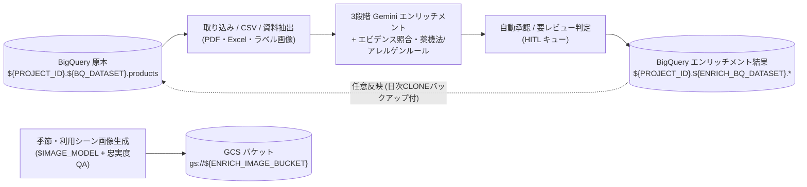

# Cymbal Retail 商品情報エンリッチメント スタジオ (`data-enrichment`)

レガシー商品マスタ・CSV・仕様書 PDF / Excel / 食品表示ラベル写真から、Vertex AI Gemini（オンライン推論＋Batch Prediction）を用いて構造化属性・検索キーワード・AI 概要・Google Merchant Center（GMC）会話型コマース属性・季節シーン画像を生成し、エビデンス検証と Human-in-the-Loop（HITL）レビューを経てゴールデンレコード化する Web アプリケーションです。

## アーキテクチャ概要



## 主な画面・機能

| 画面 | 内容 |
|---|---|
| **ダッシュボード** | 属性充足率（Before / After）、自動承認率、カテゴリ別進捗、トークン・コスト集計 KPI |
| **商品一覧・スタジオ** | 商品別の Before / After 比較、エビデンスハイライト、選択した Gemini 3.x+ モデルでのライブ再実行 |
| **CSV 一括投入 / 資料から抽出** | CSV アップロード、メーカー仕様書 PDF・価格表 Excel・食品表示ラベル画像（サンプル同梱）からの属性抽出・JAN 自動照合・差分適用 |
| **季節・シーン画像スタジオ** | 原本パックショットを参照画像とし、季節イベント・食卓シーン画像を生成して製品忠実度を自動採点 |
| **GMC / AI モード属性** | Google Merchant Center 向け Q&A・ハイライト・構造化詳細の生成と TSV エクスポート |
| **HITL レビュー** | 確信度閾値やアレルゲン表示根拠不足により保留された属性の承認・却下・修正ワークフロー |
| **バッチ実行・コスト試算** | Vertex AI Batch Prediction ジョブ管理および公式定価ベースの USD/JPY コストシミュレーター |

## 環境変数

| 変数名 | 既定値 | 説明 |
|---|---|---|
| `PROJECT_ID` | （必須） | Google Cloud プロジェクト ID |
| `REGION` / `BQ_LOCATION` | `asia-northeast1` | Cloud Run および BigQuery リージョン |
| `BQ_DATASET` | `cymbal` | 参照元の商品カタログ BigQuery データセット |
| `BQ_SOURCE_TABLE` | `${PROJECT_ID}.${BQ_DATASET}.products` | 原本商品マスタテーブル |
| `ENRICH_BQ_DATASET` | `cymbal_enrichment` | エンリッチメント結果格納用 BigQuery データセット（`BQ_DATASET` とは別名必須） |
| `ENRICH_IMAGE_BUCKET` / `IMAGE_BUCKET` | `products_images_${PROJECT_ID}` | 生成画像・アップロード資料・バッチ入出力用 GCS バケット |
| `ENRICH_SERVICE` | `${SERVICE_PREFIX}-data-enrichment` | Cloud Run サービス名 |
| `STORE_URL` / `ONLINE_STORE_URL` | オンラインストア Cloud Run URL | ヘッダー右上「ストアデモ（ADK）」アイコンのリンク先 |
| `ENRICH_GEMINI_MODEL` | `gemini-3.8-flash` | 既定の属性抽出・GMC 生成用 Gemini モデル |
| `IMAGE_MODEL` | `gemini-3.1-flash-image` | 季節・シーン画像生成モデル |

## セットアップ・デプロイ・テスト

### 1. BigQuery テーブル初期化（手動セットアップ時）

一括インストーラ（`install/install.sh`）を使う場合は自動でシードデータがロードされます。空の状態から初期化する場合は以下を実行します。

```bash
source install/config.env
cd data-enrichment
PYTHONPATH=. uv run --no-project --with-requirements requirements.txt python scripts/setup_bq.py
```

### 2. Cloud Run へのデプロイ

```bash
source install/config.env
./data-enrichment/deploy.sh
```

### 3. ローカル起動（オフラインモックモード）

GCP 接続なしでインメモリデモデータを使って動作確認できます。

```bash
cd data-enrichment
OFFLINE=true uv run --no-project --with-requirements requirements.txt uvicorn app.main:app --port 8085
```

### 4. ユニットテスト実行

```bash
cd data-enrichment
uv run --no-project --with-requirements requirements.txt --with pytest --with httpx \
  pytest -q --ignore=tests/e2e
```
