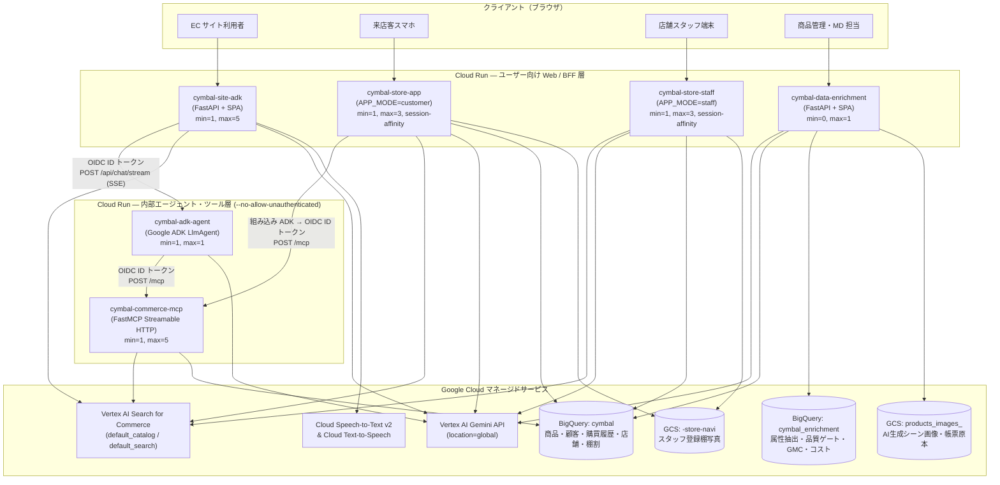
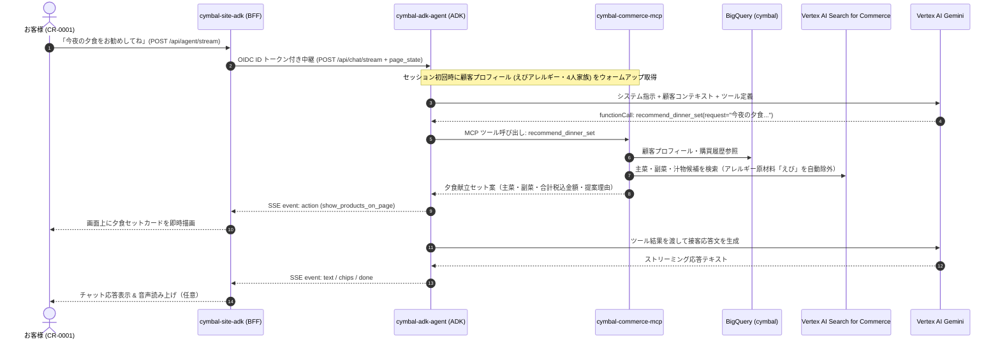
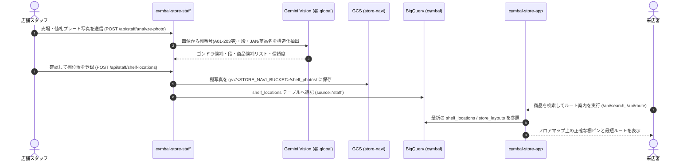

# アーキテクチャ設計書 (`docs/ARCHITECTURE.md`)

本書では、Cymbal Retail エージェンティック・コマース デモの全体構成、Cloud Run サービス間の認証境界、データフロー、および環境変数仕様について解説します。

---

## 1. サービス構成とセキュリティ境界

本デモは単一の Google Cloud プロジェクト上に **8 つの Cloud Run サービス**（公開 Web 6 サービス + IAM 保護された内部 API 2 サービス）を展開します。すべてのサービスは最小権限の専用サービスアカウント（既定: `cymbal-runtime@<PROJECT_ID>.iam.gserviceaccount.com`）で稼働します。

---

## 2. 主要ユースケースのシーケンス

### 2.1 オンラインストア：AIコンシェルジュによる夕食セット提案〜注文確定

オンラインストア (`cymbal-site-adk`) のチャット欄は、ブラウザと BFF 間で Server-Sent Events (SSE) ストリームを維持し、ツール実行による UI 操作アクション（`show_products_on_page`, `add_to_cart`, `start_checkout`, `select_delivery_slot`, `place_order`）をリアルタイムに画面へ反映します。

### 2.2 店舗ナビ：スタッフによる売場写真登録とお客様マップへの即時反映

`store-navi` は 1 つのコンテナイメージから環境変数 `APP_MODE`（`staff` / `customer`）によって 2 つの専用サービスとして稼働し、BigQuery `cymbal` データセットと GCS バケットを介してリアルタイムに連携します。

### 2.3 商品情報エンリッチメント スタジオ：3 段階パイプラインと品質ゲート

1. **ステージ 1（属性抽出・単位正規化）**: 商品タイトル・レガシー説明文・アップロードされた仕様書 PDF / 価格表 Excel / パッケージ画像から、カテゴリ別スキーマに沿った構造化属性と根拠箇所 (`evidence`) を Gemini で抽出。
2. **品質ゲート判定（Gate 1 / Gate 2）**:
   - **Gate 1（ルール検証）**: 必須単位正規化・28 品目アレルゲン整合性・禁止表現チェック。
   - **Gate 2（複合信頼度スコア）**: 根拠一致度 (`evidence_match`) × 自己評価 (`self_conf`) × トークン確信度 (`token_conf`) からスコアを算出し、閾値以上を `auto_approved`（自動承認）、中間を `needs_review`（人間レビュー待ち）、不整合を `rejected`（却下）に自動振り分け。
3. **ステージ 3 & GMC 生成**: 承認属性から検索キーワード・AI 要約（ゴールデンレコード）および Google Merchant Center 会話型コマース用フィード（Q&A・ハイライト・バリアント）を生成。

---

## 3. 決定論的 URL 設計と相互リンク注入

Cloud Run v2 では、各サービスに `https://<SERVICE_NAME>-<PROJECT_NUMBER>.<REGION>.run.app` 形式の決定論的 URL が割り当てられます。インストーラー（`install/lib/common.sh` および `install/steps/70_apps.sh`）は以下の仕組みで循環依存なしに相互リンクを解決します。

1. デプロイ前に `gcloud projects describe` で `PROJECT_NUMBER` を取得し、全 6 サービスの URL を算出。
2. カタログ JSONL 内の商品 URL・画像 URL を `ONLINE_STORE_URL` に書き換えてから BigQuery / Retail API / 各コンテナに配布。
3. 各フロントエンドに相互遷移用環境変数を注入:
   - `cymbal-site-adk`: `ENRICH_URL`（ヘッダーからエンリッチメントスタジオへ遷移）、`ADK_AGENT_URL`
   - `cymbal-store-app`: `ONLINE_STORE_URL`（EC で購入リンク）、`STAFF_URL`（スタッフ画面切替リンク）、`MCP_URL`
   - `cymbal-store-staff`: `ONLINE_STORE_URL`、`CUSTOMER_URL`（お客様画面切替リンク）、`MCP_URL`
   - `cymbal-data-enrichment`: `STORE_URL`（オンラインストアへ戻るリンク）、`PUBLIC_BASE_URL`
4. `70_apps.sh` 完了時に `gcloud run services describe --format='value(status.url)'` で実測 URL を検証し、万一予測 URL と異なる形式が返された場合は `gcloud run services update --update-env-vars` で自動補正します。

---

## 4. 正規環境変数一覧 (`install/config.env` / `common.sh`)

| 環境変数名 | 既定値 / 算出規則 | 用途 |
|---|---|---|
| `PROJECT_ID` | （必須） | デプロイ先 Google Cloud プロジェクト ID |
| `PROJECT_NUMBER` | 自動取得 | 決定論的 Cloud Run URL および Retail リソース名の構築 |
| `REGION` | `asia-northeast1` | Cloud Run / BigQuery / Cloud Storage のリージョン |
| `GEMINI_LOCATION` | `global` | Vertex AI Gemini API のエンドポイントロケーション |
| `SERVICE_PREFIX` | `cymbal` | 全 Cloud Run サービス名・ランタイム SA の接頭辞 |
| `RUNTIME_SA` | `${SERVICE_PREFIX}-runtime@${PROJECT_ID}.iam.gserviceaccount.com` | 全 6 サービス共通の実行サービスアカウント |
| `BQ_DATASET` | `cymbal` | カタログ・顧客・購買履歴・店舗ナビ用 BigQuery データセット |
| `ENRICH_BQ_DATASET` | `cymbal_enrichment` | エンリッチメントスタジオ用 BigQuery データセット |
| `CATALOG_BUCKET` | `${PROJECT_ID}-catalog` | Retail インポート用カタログ JSONL・エラーログ保管バケット |
| `STORE_NAVI_BUCKET` | `${PROJECT_ID}-store-navi` | 店舗ナビの売場棚写真保管バケット |
| `ENRICH_IMAGE_BUCKET` | `products_images_${PROJECT_ID}` | エンリッチメントスタジオの生成画像・帳票サンプル保管バケット |
| `GEMINI_MODEL` | `probe_models.py` で自動検出 | サイト AI 概要・店舗ビジョン等の高速テキストモデル |
| `AGENT_MODEL` | `probe_models.py` で自動検出 | ADK エージェント用の Function Calling 対応最新モデル |
| `ENRICH_GEMINI_MODEL` | `probe_models.py` で自動検出 | エンリッチメント抽出・GMC 生成用 Gemini 3.x モデル |
| `IMAGE_MODEL` | `probe_models.py` で自動検出 | 商品パックショット・季節シーン生成用画像モデル |
| `VOICE_ENABLED` | `1` | オンラインストアの音声入力 (STT) / 音声読み上げ (TTS) 有効化 |
| `BRAND_NAME` | `Cymbal Retail` | ストア・Retail 会話型検索のブランド表示名 |
