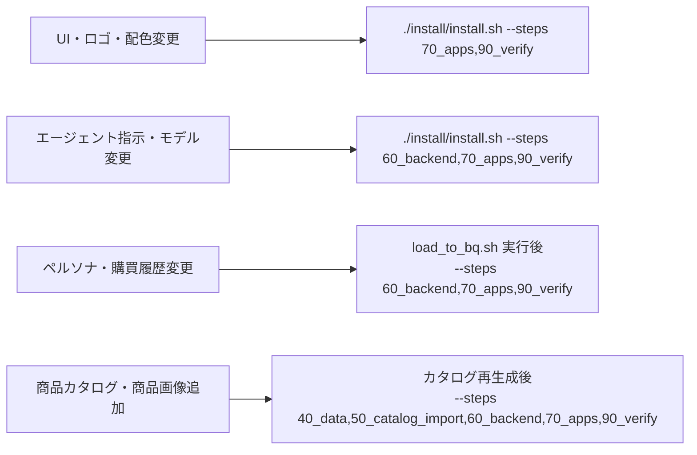

# カスタマイズガイド (`docs/CUSTOMIZE.md`)

Cymbal Retail デモは、すべてのプロジェクト固有設定を `install/config.env` に集約し、カタログ・ペルソナ・店舗データ・プロンプトをモジュール化しているため、提案先のお客様（スーパーマーケット、ドラッグストア、ホームセンター、百貨店、専門 EC など）に合わせて短時間で改装できます。

> **ヒント**: Jetski をお使いの場合は、`_agents/skills/customize-cymbal-demo/SKILL.md` スキルにより自然言語の指示でこれらの手順を自動実行できます。

---

## 1. 部分再デプロイの基本（`--steps` の使い分け）

カスタマイズ後は全ステップを最初からやり直す必要はありません。変更したレイヤーに対応するステップのみを指定して数分で反映できます。



---

## 2. ブランド名・ロゴ・テーマカラーの変更

### 2.1 ブランド表示名の変更
`install/config.env` の `BRAND_NAME` を編集します:
```bash
BRAND_NAME="〇〇スーパー ネット便"
```

### 2.2 各アプリのロゴ・カラートークン編集箇所

| 対象アプリ | ロゴ・アイコン | カラー・CSS 変数・タイトル |
|---|---|---|
| **ADK オンラインストア** | `online-store-adk/static/img/logo.svg`<br/>`online-store-adk/static/img/favicon.svg` | `online-store-adk/static/css/theme.css` (`:root` のブランド色変数)<br/>`online-store-adk/static/index.html` (`<title>`・ヘッダー表記) |
| **店舗ナビ（お客様 / スタッフ）** | `store-navi/static/shared/img/` | `store-navi/static/shared/css/`（共通デザイントークン）<br/>`store-navi/static/customer/index.html`, `store-navi/static/staff/index.html` |
| **商品情報エンリッチメント** | `data-enrichment/static/index.html` 内ヘッダー SVG | `data-enrichment/static/css/`（アクセントカラー・バッジ色）<br/>`data-enrichment/static/index.html` |

### 2.3 反映コマンド
```bash
./install/install.sh --steps 30_retail,70_apps,90_verify
```

---

## 3. 商品の追加・差し替えと著作権セーフな AI 商品画像生成

提案先企業の主力カテゴリ（例: ご当地惣菜、PB 日用品、OTC 医薬品、ペット用品、アパレル雑貨など）を追加する場合の手順です。

### 3.1 ブループリント JSON の作成
`shared/catalog/blueprint/` 配下の既存 JSON を参考に、新規ファイル（例: `shared/catalog/blueprint/z_custom_items.json`）を作成します。

```json
{
  "category_group": "お惣菜・お弁当",
  "items": [
    {
      "base_id": "custom_deli_dashi_tamago",
      "category_path": ["お惣菜・お弁当", "和風惣菜", "玉子焼き"],
      "brand": "Cymbal セレクト",
      "storage_type": "冷蔵食品",
      "origin": "国内製造",
      "allergens": ["卵", "小麦", "大豆"],
      "dishes": ["お弁当", "夕食のおかず"],
      "season_months": [1, 2, 3, 4, 5, 6, 7, 8, 9, 10, 11, 12],
      "images": ["custom_deli_dashi_tamago_p.jpg"],
      "image_brief": "Sliced Japanese rolled dashi omelet (dashimaki tamago) in a clear supermarket deli pack",
      "variants": [
        {
          "title": "Cymbal セレクト 京風だしまき玉子 1パック（6切入）",
          "size": "6切入",
          "price_tax_excluded": 298,
          "description": "かつおと昆布の一番だしをたっぷり閉じ込め、ふっくら焼き上げただしまき玉子です。"
        }
      ]
    }
  ]
}
```

### 3.2 Gemini による商品パックショット生成（白背景・文字/ロゴなし自動検品）
`shared/catalog/gen_vertex.py` は、`IMAGE_MODEL`（例: `gemini-3.1-flash-image`）で純白背景の商品写真を生成した後、`GEMINI_MODEL` による視覚品質検査（文字・ロゴ混入なし、純白背景、商品一致）を自動実行し、合格した画像のみを採用します。

```bash
source install/lib/common.sh && load_config

# 1. 未生成の商品画像を生成（著作権・商標リスクのない文字なし白背景パックショット）
GEN_MODEL="${IMAGE_MODEL}" QA_MODEL="${GEMINI_MODEL}" \
  uv run --no-project --with google-genai --with pillow \
  python3 shared/catalog/gen_vertex.py --blueprints shared/catalog/blueprint/z_custom_items.json

# 2. 600x600 JPEG にリサイズして online-store-adk/static/img/products/ に配置
uv run --no-project --with pillow python3 shared/catalog/apply_packshots.py
```

### 3.3 カタログ JSONL の展開・検証とクラウドへの反映
```bash
source install/lib/common.sh && load_config

# カタログ JSONL を再生成してバリデーション実行
python3 shared/catalog/generate_catalog.py \
  --out seed/catalog/products_retail.jsonl \
  --base-url "${ONLINE_STORE_URL}"
python3 shared/catalog/validate_jsonl.py seed/catalog/products_retail.jsonl

# URL 書き換えキャッシュを更新するため古い一時ファイルを削除して再投入・再デプロイ
rm -f install/.state/products_retail.rewritten.jsonl
./install/install.sh --steps 40_data,50_catalog_import,60_backend,70_apps,90_verify
```

---

## 4. 顧客ペルソナ・アレルギー設定・購買履歴の変更

オンラインストアの AIコンシェルジュと推薦エンジンは、顧客プロフィール（家族構成・好み・アレルギー除外キーワード）と過去の購買履歴をもとにパーソナライズ提案を行います。

1. `seed/personas/personas.json` を編集します:
   - `exclude_keywords`: アレルギーや NG 原材料（例: `["えび", "エビ", "海老", "そば"]`）— 検索・夕食セット提案で自動除外されます。
   - `household` / `family_preferences`: 家族構成やメンバーごとの好物キーワード。
2. 購買履歴を再生成し、BigQuery `cymbal.customers` / `cymbal.purchase_history` を更新します:
   ```bash
   source install/lib/common.sh && load_config
   python3 seed/personas/generate_history.py \
     --products seed/catalog/products_retail.jsonl \
     --out seed/personas/purchase_history.jsonl
   bash seed/personas/load_to_bq.sh
   ```
3. MCP サーバーとオンラインストアへ反映します:
   ```bash
   ./install/install.sh --steps 60_backend,70_apps,90_verify
   ```

---

## 5. 店舗レイアウト・棚割・クーポンの変更 (`store-navi`)

### 方法 A: 管理画面 (`/admin`) からブラウザ上で編集（コード変更不要）
デプロイ済みのスタッフアプリ URL に `/admin` を付けて開く（例: `https://cymbal-store-staff-<PROJECT_NUMBER>.asia-northeast1.run.app/admin`）と、**棚番管理エディタ**からフロアマップ上のゴンドラ配置・サイズ・棚番号を編集して BigQuery `cymbal.store_layouts` へ即時公開できます。数秒以内にスタッフ画面・お客様画面の双方へ自動反映されます。

### 方法 B: スクリプト定義から店舗マスタ一式を再構築
1. 店舗一覧 (`store-navi/data/stores.json`)、クーポン (`store-navi/data/coupons.json`)、特売情報 (`store-navi/data/offers.json`)、またはレイアウト定義 (`store-navi/scripts/store_layout_defs.py`) を編集します。
2. 店舗データビルドスクリプトと BigQuery セットアップを実行し、アプリを再デプロイします:
   ```bash
   source install/lib/common.sh && load_config
   python3 store-navi/scripts/build_store_data.py
   python3 store-navi/scripts/setup_bq.py --skip-iam --reset-shelf
   ./install/install.sh --steps 70_apps,90_verify
   ```

---

## 6. AIコンシェルジュのシステムプロンプト・モデルのカスタマイズ

### 6.1 オンラインストア AIコンシェルジュ (`shared/adk_agent`)
- プロンプト定義: `shared/adk_agent/cymbal_agent/agent.py` 内の `BASE_INSTRUCTION`
  - `<role>`: エージェントの役割・取り扱いカテゴリ
  - `<allergy>`: アレルギー配慮ルール
  - `<dinner_set>`: 献立・セット提案ルール（例: 週末 BBQ セットやホームパーティー提案への応用も可能）
  - `<search>` / `<compare>` / `<checkout>`: 検索・比較表・配送枠確認の振る舞い
- ツール定義: `shared/adk_agent/cymbal_agent/tools.py` および `shared/mcp_server/server.py`

### 6.2 Gemini モデル・音声設定の切り替え
`install/config.env` でモデルや音声機能の ON/OFF を調整できます:
```bash
GEMINI_MODEL="gemini-3.8-flash"
AGENT_MODEL="gemini-3.8-flash"
ENRICH_GEMINI_MODEL="gemini-3.8-flash"
IMAGE_MODEL="gemini-3.1-flash-image"
VOICE_ENABLED="0"   # 音声マイク・自動読み上げを無効化したい場合は 0
```

変更後は以下のコマンドで反映します:
```bash
./install/install.sh --steps 60_backend,70_apps,90_verify
```
