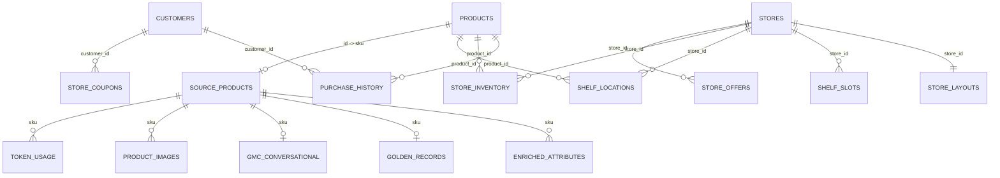

# データ仕様・スキーマリファレンス (`docs/DATA.md`)

本書では、`seed/` ディレクトリに収録され `40_data` / `50_catalog_import` ステップで対象 Google Cloud プロジェクトに投入される全データアセット（商品カタログ、BigQuery 23 テーブル、Cloud Storage 2 バケット、組み込み商品画像）の構造と件数を記載します（メタデータ原本: `seed/MANIFEST.json`）。

> **個人情報・著作権に関する安全性**: 収録されている顧客ペルソナ（`CR-0001`〜`CR-0003`）・購買履歴・スタッフ名はすべて架空の合成データであり、実在の個人情報は一切含まれません。また商品画像はすべて Gemini 画像生成モデルで「文字・ブランドロゴなし・純白背景」として生成されたデモ専用画像です。

---

## 1. データ全体マップ（ER / データ配置図）

---

## 2. 商品カタログ・検索候補・ペルソナ原本 (`seed/catalog/`, `seed/personas/`)

| パス | 形式 | 件数 | 内容・用途 |
|---|---|---:|---|
| `seed/catalog/products_retail.jsonl` | NDJSON | 21,534 件 | Vertex AI Search for Commerce `Product` スキーマ準拠の全商品マスタ（食品・惣菜・関西名物・日用品・キッチン・美容・ペット・インテリア・OTC 医薬品）。インストール時に `uri` と `images[].uri` が `$ONLINE_STORE_URL` に自動置換されます。 |
| `seed/catalog/products.schema.json` | JSON | 29 列 | `cymbal.products` テーブル用 BigQuery スキーマ定義。 |
| `seed/catalog/autocomplete_suggestions.jsonl` | NDJSON | 7,280 件 | デモシナリオクエリ・カテゴリ・ブランド・短縮商品名から構築されたオートコンプリート候補（Retail Completion API 非利用環境でのローカルフォールバックにも使用）。 |
| `seed/personas/personas.json` | JSON | 1 名 (`CR-0001`) | オンラインストア既定ペルソナ「さくら」（4 人家族、長女のえびアレルギー除外キーワード `えび/エビ/海老/シュリンプ`、家族の好物設定）。 |
| `seed/personas/purchase_history.jsonl` | NDJSON | 685 件 | `CR-0001` の過去購買明細（リピート購入・おすすめ算出用）。 |
| `online-store-adk/static/img/products/` | JPEG (600×600) | 4,100 枚超 | Gemini 生成・検品済みの商品パックショット画像（`online-store-adk` と `store-navi` のコンテナに同梱配信）。 |

---

## 3. BigQuery データセット `cymbal`（13 テーブル：カタログ 1 + シード 12）

デプロイ先リージョン（既定: `asia-northeast1`）の `${PROJECT_ID}:${BQ_DATASET}`（既定: `cymbal`）に `WRITE_TRUNCATE` でロードされます。

| テーブル名 | 初期件数 | 主キー / 粒度 | 主なカラムと役割 |
|---|---:|---|---|
| `products` | 21,534 | `id` | Retail API インポート元マスタ。`title`, `categories`, `brands`, `priceInfo`, `attributes`（`on_sale`, `dishes`, `allergens`, `drug_class`, `symptoms` 等）, `uri`, `images` |
| `customers` | 3 | `customer_id` | `CR-0001`（EC 既定・えびアレルギー配慮）、`CR-0002`・`CR-0003`（店舗ナビ来店ペルソナ）。ネスト構造に加え `profile_json` 文字列も保持 |
| `purchase_history` | 808 | `order_id`, `product_id` | `CR-0001`〜`CR-0003` の購買履歴明細（`order_date`, `quantity`, `unit_price_tax_included`, `amount`） |
| `autocomplete_suggestions` | 7,280 | `suggestion` | Retail `completionData:import` 用テーブル（`suggestion`, `globalScore`, `frequency`, `languageCode`） |
| `stores` | 3 | `store_id` | 店舗マスタ（`S01`〜`S03`：住所・緯度経度・営業時間・調剤薬局営業時間・提供サービス・`layout_id`） |
| `store_layouts` | 29 | `store_id`, `version` | フロアマップのゴンドラ・壁面什器・レジ・調剤カウンター座標 JSON（バージョン履歴付き） |
| `store_layout_changes` | 26 | `store_id`, `version` | 棚番管理画面 (`/admin`) からのレイアウト変更・公開監査ログ |
| `shelf_slots` | 46,938 | `store_id`, `slot_id` | 各什器・段・スロット単位の物理座標 (`x`, `y`, `width_cm`, `fixture_type`) |
| `shelf_locations` | 59,029 | `store_id`, `product_id` | 商品の陳列棚番マッピング（`fixture_id`, `slot_ids`, `tier`, `photo_uri`, `source`=`seed`/`staff`）。`photo_uri` は対象プロジェクトの `gs://${STORE_NAVI_BUCKET}/...` に自動置換 |
| `store_inventory` | 58,418 | `store_id`, `product_id` | 店舗別リアルタイム在庫数 (`quantity`) と在庫ステータス (`in_stock`, `low_stock`, `out_of_stock`) |
| `store_inventory_events` | 16 | イベント行 | スタッフアプリからの在庫数変更履歴ログ |
| `store_coupons` | 14 | `coupon_id` | 来店客向けパーソナルクーポン（対象カテゴリ / 対象商品 ID・割引額・有効期限） |
| `store_offers` | 36 | `store_id`, `product_id` | 店舗別の特売・チラシ連動オファー（`sale_price`, `original_price`, `badge`） |

---

## 4. BigQuery データセット `cymbal_enrichment`（10 テーブル）

商品情報エンリッチメント スタジオ（`cymbal-data-enrichment`）が参照・更新する `${PROJECT_ID}:${ENRICH_BQ_DATASET}`（既定: `cymbal_enrichment`）のテーブル群です。

| テーブル名 | 初期件数 | 主キー / 粒度 | 主なカラムと役割 |
|---|---:|---|---|
| `source_products` | 49 | `sku` | エンリッチメント対象の厳選デモ SKU（一部は意図的に全角数字・記号混じりのレガシー記述 `source='legacy_master'` として収録し、構造化前後の比較を実演）。`product_url`, `image_url`, `doc_sources_json` は対象プロジェクトの URL / バケットに自動置換 |
| `enriched_attributes` | 512 | `sku`, `attr_key` | Gemini が抽出した属性・タグ候補、原文根拠 (`evidence`)、3 指標信頼度スコア、品質ゲート判定 (`auto_approved` / `needs_review` / `rejected`) |
| `sku_extras` | 61 | `sku` | ステージ 3 で生成された検索キーワード配列 (`search_keywords`) と AI 商品要約 (`ai_summary`) |
| `golden_records` | 62 | `sku` | 承認済み属性を統合したゴールデンレコードと属性充足率の改善推移 (`fill_rate_before` → `fill_rate_after`) |
| `review_log` | 1 | レビュー操作行 | 担当者による承認・編集・却下のヒューマン・イン・ザ・ループ監査履歴 |
| `gmc_conversational` | 62 | `sku` | Google Merchant Center 会話型コマース仕様フィールド（`question_and_answer`, `product_highlight`, `product_detail`, `variant_option` 等） |
| `product_images` | 17 | `image_id` | Gemini 画像モデルで生成された季節・利用シーン別バリエーション画像のメタデータと忠実度スコア (`gcs_uri` は `gs://${ENRICH_IMAGE_BUCKET}/...` に自動置換) |
| `doc_extractions` | 1 | `job_id`, `product_index` | PDF 仕様書・Excel 価格表・パッケージラベル画像からのマルチモーダル属性抽出履歴 (`file_uri` 自動置換) |
| `batch_jobs` | 6 | `job_id` | Vertex AI Batch Prediction 実行ジョブ履歴・トークン集計・円換算コスト |
| `token_usage` | 26 | 計測行 | モデル別「サンプル 1 件で計測」およびオンライン実行の実測入力/出力/思考トークン数（コスト試算画面の基礎データ） |

---

## 5. Cloud Storage バケットとシードオブジェクト (`seed/gcs/`)

`40_data` ステップで均一バケットレベルアクセス (`--uniform-bucket-level-access`) により作成され、アプリケーション BFF 経由で安全に配信されます（バケット自体を公開する必要はありません）。

| 環境変数 | 既定バケット名 | 初期オブジェクト数 | 内容 |
|---|---|---:|---|
| `CATALOG_BUCKET` | `${PROJECT_ID}-catalog` | 2+ | URL 書き換え済みの `catalog/products_retail_latest.jsonl` および Retail インポートエラー出力先 (`import_errors/`) |
| `STORE_NAVI_BUCKET` | `${PROJECT_ID}-store-navi` | 14 ファイル (約 2.0 MB) | `shelf_photos/S01/*.jpg` — スタッフアプリで登録済みの売場・棚番写真シード |
| `ENRICH_IMAGE_BUCKET` | `products_images_${PROJECT_ID}` | 21 ファイル (約 2.5 MB) | `4925319234365/*.jpg`（生成済み季節シーン画像）、`_samples/`（帳票抽出デモ用の仕様書 PDF・冬季鍋価格表 Excel・商品ラベル PNG）、`_docs_uploads/` |
