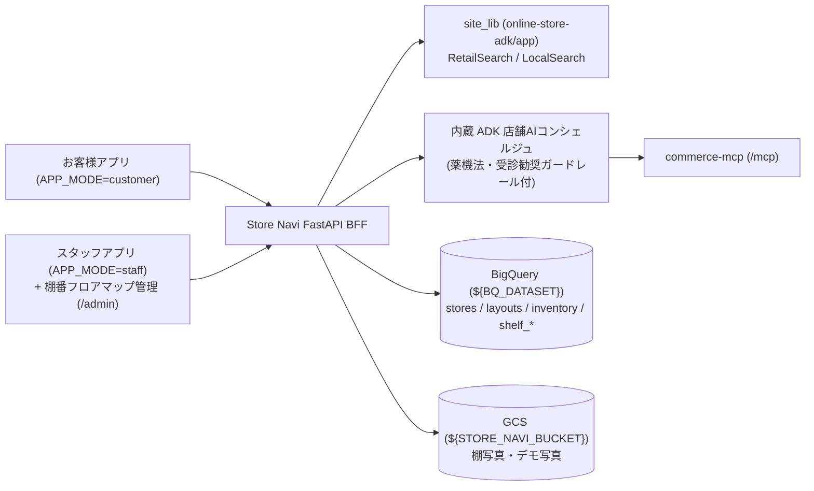

# Cymbal Store Navi — 店舗ナビ・スタッフアプリ (`store-navi`)

ドラッグ＆フード複合店舗（川崎駅前店 `S01`・武蔵小杉店 `S02`・渋谷店 `S03`）における **お客様向け店舗ナビアプリ（`APP_MODE=customer`）** と **店舗スタッフ向け棚番・在庫管理アプリ（`APP_MODE=staff`）** を単一コードベース・単一コンテナイメージで提供する FastAPI アプリケーションです。

## アーキテクチャ概要



## 主な機能

- **お客様アプリ (`${STORE_APP_SERVICE}`)**:
  - GPS / 店舗シミュレーションによる最寄り店舗チェックイン、パーソナライズドクーポン・店舗別特価表示
  - Vertex AI Search for Commerce 連携の店舗在庫検索（現在店舗の在庫・棚番・段数、近隣店舗在庫、オンライン購入リンク）
  - フロアマップ上の棚位置ハイライト、立面図（段×スロット）表示、複数商品の最短巡回ルート案内
  - 薬機法・適正広告基準・レッドフラグ受診勧奨ガードレールを備えた店舗 AI コンシェルジュ（ADK）
- **スタッフアプリ (`${STORE_STAFF_SERVICE}`)**:
  - 棚写真の撮影 / デモギャラリーからの Gemini Vision 解析による什器プレート・スロット番号・商品の自動認識と棚番登録
  - タッチ操作最適化された在庫検索・数量ステッパー調整・欠品（0 件）登録・変更履歴確認
  - 管理者向けフロアマップ・什器・ゾーニング編集画面（`/admin`）と BigQuery バージョン管理連携

## 環境変数

| 変数名 | 既定値 | 説明 |
|---|---|---|
| `PROJECT_ID` | （必須） | Google Cloud プロジェクト ID |
| `PROJECT_NUMBER` | 自動取得 | Google Cloud プロジェクト番号 |
| `REGION` | `asia-northeast1` | Cloud Run / BigQuery / GCS リージョン |
| `SERVICE_PREFIX` | `cymbal` | Cloud Run サービス名のプレフィックス |
| `STORE_APP_SERVICE` | `${SERVICE_PREFIX}-store-app` | お客様アプリ Cloud Run サービス名 |
| `STORE_STAFF_SERVICE` | `${SERVICE_PREFIX}-store-staff` | スタッフアプリ Cloud Run サービス名 |
| `STORE_NAVI_BUCKET` | `${PROJECT_ID}-store-navi` | 棚写真格納用 GCS バケット名 |
| `ONLINE_STORE_URL` | `https://${ONLINE_STORE_SERVICE}-${PROJECT_NUMBER}.${REGION}.run.app` | オンラインストア URL（商品購入リンク・ヘッダーリンク） |
| `STAFF_URL` / `CUSTOMER_URL` | 各サービスの Cloud Run URL | お客様アプリ⇔スタッフアプリ間のヘッダーアイコンリンク |
| `ENRICH_URL` | 空（任意） | 設定時にヘッダーへエンリッチメントスタジオへのリンクを表示 |
| `MCP_URL` | `shared/mcp_server/DEPLOYMENT.env` から解決 | `commerce-mcp` ベース URL |
| `AGENT_MODEL` | `${GEMINI_MODEL}`（既定 `gemini-3.8-flash`） | 店舗 AI コンシェルジュおよび棚画像解析モデル |

## デプロイ・ローカル実行・テスト

### Cloud Run へのデプロイ

```bash
source install/config.env

# お客様向けアプリのデプロイ
SERVICE_NAME="${STORE_APP_SERVICE:-${SERVICE_PREFIX:-cymbal}-store-app}" ./store-navi/deploy.sh

# スタッフ向けアプリのデプロイ
SERVICE_NAME="${STORE_STAFF_SERVICE:-${SERVICE_PREFIX:-cymbal}-store-staff}" ./store-navi/deploy.sh
```

### ローカル開発起動（ファイルモード）

```bash
cd store-navi

# お客様アプリ (ポート 8090)
DATA_MODE=local STAFF_URL=http://127.0.0.1:8091 \
  uv run --no-project --with-requirements requirements.txt uvicorn app.main:app --port 8090

# スタッフアプリ (ポート 8091)
DATA_MODE=local APP_MODE=staff CUSTOMER_URL=http://127.0.0.1:8090 \
  uv run --no-project --with-requirements requirements.txt uvicorn app.main:app --port 8091
```

### ユニットテスト実行

```bash
cd store-navi
uv run --no-project --with-requirements requirements.txt --with pytest --with httpx \
  pytest -q --ignore=tests/e2e_admin.py --ignore=tests/e2e_customer.py --ignore=tests/e2e_staff.py --ignore=tests/e2e_staff_map.py
```
